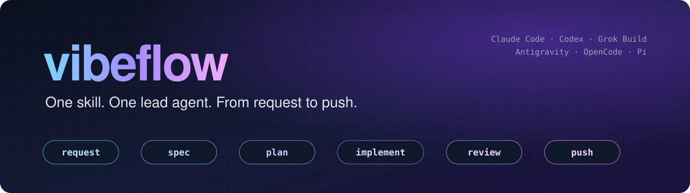
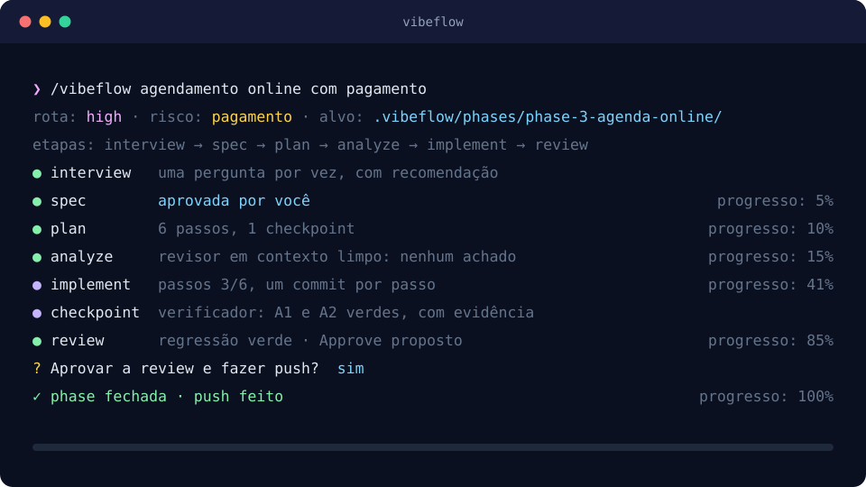
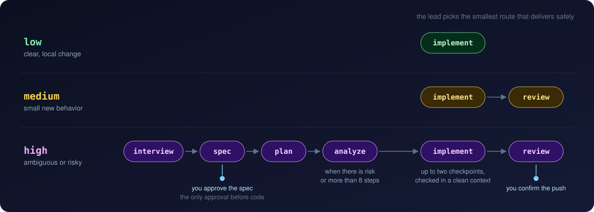

<p align="center">
  
</p>

<p align="center">
  <b>English</b> · <a href="README.pt-BR.md">Português (Brasil)</a>
</p>

<p align="center">
  <a href="LICENSE"></a>
  <a href="https://github.com/korflux/vibeflow/stargazers"></a>
  
  
  
</p>

# vibeflow

**An agent skill that turns your coding agent into a lead: it sizes the request, plans it, delegates the code to subagents, checks every delivery and only pushes when you say so.**

vibeflow is a single `SKILL.md` package for Claude Code, Codex, Grok Build, Antigravity, OpenCode, Pi and any client that reads agent skills. You call `/vibeflow`, describe what you want, and the lead agent runs the whole delivery, from the first question to the final push. The state lives on disk and in Git, never in the chat, so a new session picks up exactly where the last one stopped.

> [!NOTE]
> The skill itself is written in Brazilian Portuguese: the lead and the subagents talk to you in PT-BR, and the artifacts they write are in PT-BR. The package, the scripts and this page work the same everywhere.

<p align="center">
  
  <br>
  <sub>Illustration of a <code>high</code> route, using the status lines the lead prints.</sub>
</p>

## Why vibeflow

- **Right-sized process.** A color tweak does not get a spec. A payment flow does. The lead picks the smallest route that delivers safely and tells you what would make it bigger.
- **One approval before code.** You approve the spec. After that the lead chains plan, analysis, implementation and review on its own, and comes back to you only for a real decision and for the push.
- **The lead never writes code.** It asks, decides, delegates and checks. Implementation, tests and proofs go to subagents, each with a narrow brief and its own files.
- **Reviews in a clean context.** Analysis, checkpoints and the final review run in fresh contexts that did not write the code, with evidence attached. A critical finding gets a second read before anyone fixes it.
- **Proof, not promises.** Every step ends with a proof and a real commit. The test for each acceptance criterion fails before the change and passes after it, and tests are never weakened, skipped or deleted to get to green.
- **Resumable by design.** The plan is a checklist on disk, every step is a commit, and a small script tells any new session the current stage and the next move.
- **Guardrails outside the prompt.** What cannot be undone (discarded work, rewritten history, secrets read into context) is blocked by the host, not just discouraged in prose.

## Quick start

Install with the [`skills`](https://github.com/vercel-labs/skills) CLI:

```bash
# this project only, shareable with your team
npx skills add korflux/vibeflow -a claude-code -a codex -a grok -a antigravity -y

# every project on this machine
npx skills add korflux/vibeflow -g -a claude-code -a codex -a grok -a antigravity -y
```

Then, inside your repo:

```text
/vibeflow add online booking with payment
```

In Codex the call is `$vibeflow`. The first time in a repo, the `init` stage runs before the first route that opens a phase: it writes `AGENTS.md`, installs the five subagent profiles and asks before changing anything that is yours.

<details>
<summary><b>More install options</b> (Windows, Antigravity, OpenCode, Pi)</summary>

<br>

- **Windows without symlink support:** add `--copy` to the command. Check the result with `npx skills list`.
- **Update:** `npx skills update vibeflow` (add `-g` for the global install).
- **OpenCode and Pi** also discover global skills in `~/.agents/skills/`. One up-to-date copy there serves both.
- **Antigravity IDE:** place this repository at `<workspace-root>/.agents/plugins/vibeflow/`, or globally at `~/.gemini/config/plugins/vibeflow/`. `plugin.json` stays at the plugin root.
- **Antigravity CLI:**

  ```text
  agy plugin install https://github.com/korflux/vibeflow.git
  agy plugin list
  ```

- **Global rule files** (`~/.codex/AGENTS.md`, `~/.gemini/GEMINI.md`) do not replace the project `AGENTS.md`, and the skill never creates `CLAUDE.md` or `GEMINI.md` in your workspace.

</details>

## How it works

<p align="center">
  
</p>

| Route | Stages | When |
|---|---|---|
| `low` | implement | A clear, local change with no new behavior, such as a color, a text or a static layout. No phase and no artifact. |
| `medium` | implement → review | A clear request with small or medium new behavior, in a flow that already has tests. |
| `high` | interview → spec → plan → analyze → implement → review | An ambiguous request, a schema migration, authentication, authorization, payment, personal data, secrets, risk of data loss, or a screen your design system does not cover. |

A `# Risco:` line in the spec marks changes that touch authentication, authorization, payment, secrets, data loss or production. It adds no stage, but it deepens the interview, places a checkpoint after the first risky group of steps and opens the security review. You can also name the route yourself, and the lead follows it.

### The team

The chat where you call `/vibeflow` is the lead. Everyone else is a subagent with a single reference file and a fixed report format.

| Role | Does | Does not |
|---|---|---|
| **Lead** | Talks to you, picks the route, delegates, checks form and direction, commits and pushes | Write code or run tests |
| **Explorer** | Maps flows, consumers and affected tests; verifies facts by probing | Write anything |
| **Writer** | Writes the spec, the plan and other prose | Write code |
| **Implementer** | Codes, proves and commits each step of its stretch | Touch files outside its step |
| **Verifier** | Runs the checkpoint in a clean context and reports with evidence | Fix what it finds |
| **Reviewer** | Runs the analysis and the final review in a clean context | Fix code or approve on your behalf |

Use your strongest reasoning model for the lead, since it decides and judges. The subagents use the model set in each profile, and the skill never swaps one for the other.

### What lands on disk

```text
AGENTS.md                                  single source of project rules
.vibeflow/phases/phase-N-slug/spec.md      what and why; the only approval before code
.vibeflow/phases/phase-N-slug/plan.md      checklist of steps, one commit each
.vibeflow/phases/phase-N-slug/review.md    verdict, findings and evidence
.vibeflow/mvp/                             single baseline for a brand-new project
```

Three files per phase, always with these names. The state comes from their header lines, the checkboxes in the plan, the findings in the review and the Git log.

## Commands

| Command | What it does |
|---|---|
| `/vibeflow` | Reads the disk, resumes the open phase or classifies a new request, and announces the route |
| `/vibeflow <request>` | Classifies the request and starts the matching route |
| `/vibeflow <stage> [request]` | Goes straight to `init`, `interview`, `spec`, `plan`, `analyze`, `implement` or `review`, if its prerequisite is met |

The skill never starts by itself. Outside a `/vibeflow` call, your agent just follows `AGENTS.md`, with no route, phase or artifact.

## Guardrails

The rule of thumb is one question: if the agent gets this wrong once, can you undo it? Wrong code can be reverted, so that stays in prose. Discarded uncommitted work, rewritten history and a secret read into the context cannot, so the host blocks them.

- **Deny rules, offered by `init`.** In Claude Code, `init` proposes writing the rules of [`claude-settings.json`](skills/vibeflow/templates/claude-settings.json) to your project `.claude/settings.json`, and only does it if you accept. They block broad staging, amend, force push, the commands that discard uncommitted work and the reading of secret `.env` files, for both `Bash` and `PowerShell`.
- **Stop hook for the implementer.** [`encerrar.mjs`](skills/vibeflow/scripts/encerrar.mjs) holds the implementer when it tries to hand back a stretch with a checked box and no commit, a commit and no checked box, or changes outside its files.
- **Command hook.** [`barrar.mjs`](skills/vibeflow/scripts/barrar.mjs) denies polling loops and monorepo-wide typecheck or test runs inside a step.
- **Commit check.** [`conferir.mjs`](skills/vibeflow/scripts/conferir.mjs) checks the message format, the staged paths against the step and a new `.only` in a test file before every commit.

The hooks are opt-in and documented, with the exact `settings.json` snippets, in the [Portuguese README](README.pt-BR.md#apoios-opcionais-do-host).

<details>
<summary><b>Read-only scripts</b></summary>

<br>

With Node 18 or newer, the skill uses the scripts in `skills/vibeflow/scripts/`. They only read the disk and Git, never write, stage or commit, and run on Windows and Linux with no dependencies. Each one speeds up a rule that is already written in the references; when they disagree, the written rule wins. Without Node, the skill follows the written rules.

| Script | Reports |
|---|---|
| `estado.mjs` | Current target, route, stage, progress, next stretch of steps, open findings, pending push and inconsistencies |
| `conferir.mjs --passo <ids>` | Uncommitted changes outside the files of a step or of a finding |
| `conferir.mjs --commit "<msg>"` | Message format, staged paths against the step, checked boxes against the ids and test markers |
| `plan.mjs` | Shape of the plan, coverage of the acceptance criteria and whether the analysis is required |
| `plan.mjs --spec` | Required sections of the spec, vague criteria and leftover placeholders |
| `medir.mjs` | Wall-clock and active hours of a phase, slowest step and findings by severity |
| `governanca.mjs` | What `init` produced: `AGENTS.md`, the bridge file and each global profile against its source |

All of them accept `--json` and exit with 0 for no finding, 1 for a finding and 2 for a usage error.

</details>

## Repository layout

```text
vibeflow/
├── skills/vibeflow/      the installable package (SKILL.md, references, templates, scripts)
├── tools/                transcript timing and behavior benchmark (not installed)
├── tests/                tests for the scripts and for tools/ (not installed)
├── assets/               images of this page
├── plugin.json           Antigravity plugin
└── CHANGELOG.md          what changed in each version
```

## Contributing

1. Contract before prose: a change to what lands on disk starts in `skills/vibeflow/references/disco.md`.
2. Scripts only read, use Node 18+ with no dependencies and have a behavior test in `tests/` (`node --test`). Tests never check the wording of the skill.
3. Before opening a pull request, run `node --test` and `git diff --check`. This repository does not use CI on GitHub.

Pull requests go against `main`. A change to an artifact path or to a behavior people already rely on is a major version, an addition that breaks nothing is a minor one and a fix is a patch. Version history is in the [changelog](CHANGELOG.md).

## Credits

Ideas and conventions borrowed from:

- [addyosmani/agent-skills](https://github.com/addyosmani/agent-skills)
- [dietrichgebert/ponytail](https://github.com/dietrichgebert/ponytail)
- [emilkowalski/skills](https://github.com/emilkowalski/skills)
- [github/spec-kit](https://github.com/github/spec-kit)
- [mattpocock/skills](https://github.com/mattpocock/skills)

## Author

[@korflux](https://github.com/korflux)

## License

[MIT](LICENSE). Use, copy, modify and redistribute it, keeping the copyright notice. No warranty.
