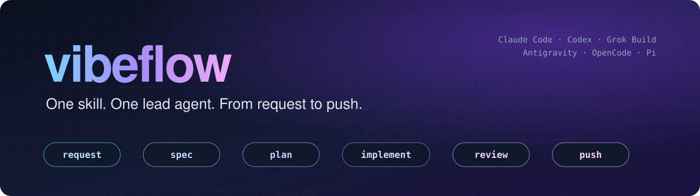
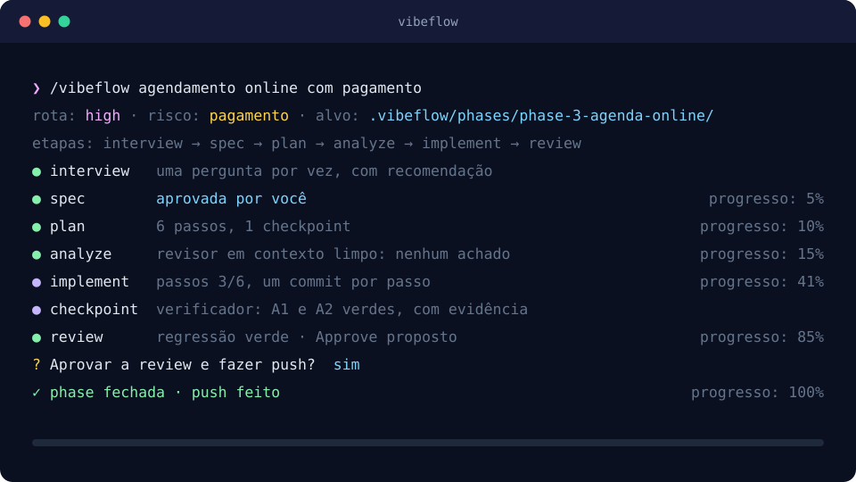
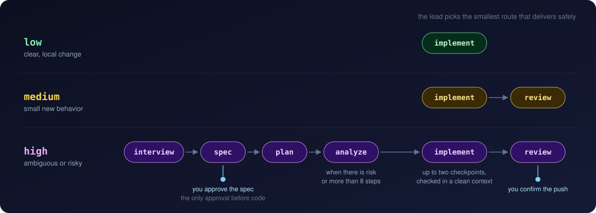

<p align="center">
  
</p>

<p align="center">
  <a href="README.md">English</a> · <b>Português (Brasil)</b>
</p>

<p align="center">
  <a href="LICENSE"></a>
  <a href="https://github.com/korflux/vibeflow/stargazers"></a>
  
  
  
</p>

# vibeflow

**A skill definitiva para VibeCoders: transforma o seu agente de código em líder. Ele dimensiona o pedido, planeja, delega o código a subagentes, confere cada entrega e só faz push quando você confirma.**

O vibeflow é um único pacote `SKILL.md` para Claude Code, Codex, Grok Build, Antigravity, OpenCode, Pi e qualquer cliente que leia skills de agente. Você chama `/vibeflow`, diz o que quer, e o líder conduz a entrega inteira, da primeira pergunta ao push final. O estado fica no disco e no Git, nunca no chat, então um chat novo retoma exatamente de onde o anterior parou.

<p align="center">
  
  <br>
  <sub>Ilustração de uma rota <code>high</code>, com as linhas de estado que o líder imprime.</sub>
</p>

## Por que usar

- **Processo do tamanho do pedido.** Trocar uma cor não ganha spec. Um fluxo de pagamento ganha. O líder escolhe a menor rota que entrega com segurança e diz o que a faria subir.
- **Uma aprovação antes do código.** Você aprova a spec. Depois disso o líder encadeia plan, analyze, implement e review sozinho, e só volta a você numa decisão real e no push.
- **O líder não escreve código.** Ele pergunta, decide, delega e confere. Código, testes e provas ficam com subagentes, cada um com um pedido estreito e os próprios arquivos.
- **Revisão em contexto limpo.** Analyze, checkpoints e a review final rodam em contextos novos, que não escreveram o código, com evidência anexada. Achado crítico passa por uma segunda leitura antes de alguém corrigi-lo.
- **Prova, não promessa.** Todo passo termina com prova e commit real. O teste de cada critério de aceite falha antes da mudança e passa depois, e nenhum teste é enfraquecido, pulado ou apagado para ficar verde.
- **Feito para retomar.** O plan é um checklist no disco, cada passo é um commit, e um script pequeno diz a qualquer chat novo a etapa atual e o próximo movimento.
- **Garantia fora do prompt.** O que não se desfaz (trabalho descartado, histórico reescrito, segredo lido para o contexto) é bloqueado pelo host, não só desaconselhado na prosa.

## Começo rápido

Com o CLI [`skills`](https://github.com/vercel-labs/skills):

```bash
# só neste projeto, compartilhável com a equipe
npx skills add korflux/vibeflow -a claude-code -a codex -a grok -a antigravity -y

# todos os projetos desta máquina
npx skills add korflux/vibeflow -g -a claude-code -a codex -a grok -a antigravity -y
```

Depois, dentro do seu repo:

```text
/vibeflow adicionar agendamento online com pagamento
```

No Codex a chamada é `$vibeflow`. Para atualizar, `npx skills update vibeflow` (com `-g` na instalação global).

<details>
<summary><b>Mais opções de instalação</b> (Windows, OpenCode, Pi, Antigravity e regras globais)</summary>

<br>

Windows sem suporte a symlink no destino: acrescente `--copy` ao comando escolhido. Use `npx skills list` para conferir a instalação.

OpenCode e Pi também descobrem skills globais em `~/.agents/skills/`. Uma cópia atualizada do pacote nesse diretório atende aos dois CLIs; se houver cópias em `~/.config/opencode/skills/` ou `~/.pi/agent/skills/`, mantenha-as sincronizadas ou remova a duplicação.

### Antigravity

IDE, plugin do workspace: coloque a pasta do repositório em `<workspace-root>/.agents/plugins/vibeflow/` (fallback documentado pelo host: `_agents/plugins/`). Uso global na IDE: `~/.gemini/config/plugins/vibeflow/`. Em ambos os casos, `plugin.json` fica na raiz do plugin e `skills/vibeflow/` contém o `SKILL.md`. Confirme a descoberta por `/skills` ou reabra o workspace.

CLI, perfil global:

```text
agy plugin install https://github.com/korflux/vibeflow.git
agy plugin list
```

O pacote fica em `~/.gemini/antigravity-cli/plugins/vibeflow/`. Para um plugin local, passe o caminho da pasta ao mesmo comando.

### Regras globais e verificação de carga

O Codex mantém regras globais em `~/.codex/AGENTS.md` ou `~/.codex/AGENTS.override.md`, e o Antigravity em `~/.gemini/GEMINI.md`. Nenhum desses arquivos substitui `AGENTS.md`, e a skill não cria `GEMINI.md` no workspace. Quando um host puder carregar mais de um nome de regra, inspecione a carga efetiva com `grok inspect` ou a ferramenta equivalente do host; reiniciar ou reabrir o host é o fallback.

</details>

## Como funciona

<p align="center">
  
</p>

| Rota | Etapas | Quando |
|---|---|---|
| `low` | implement, com prova proporcional, sem criar `.vibeflow/` | Mudança clara e localizada, sem comportamento novo, como cor, texto ou layout de página estática |
| `medium` | implement → review | Pedido claro, com comportamento novo pequeno ou médio, em fluxo que já tem testes |
| `high` | interview → spec → plan → analyze (com `# Risco:` ou mais de 8 passos) → implement com até dois checkpoints → review | Pedido ambíguo, migration de schema, autenticação, autorização, pagamento, dado pessoal, segredo, risco de perda de dados ou tela que o design system não cobre |

Na `high`, a linha `# Risco:` marca mudanças que tocam autenticação, autorização, pagamento, segredo, perda de dados ou produção; ela não acrescenta etapa, mas aprofunda a interview, os checkpoints e a review. A aprovação da `spec.md` é a única antes do código: com ela, o líder segue até a review sem pedir outras aprovações. Você também pode nomear a rota no pedido, e o líder a segue. A tabela de rotas fica no `AGENTS.md` que a etapa `init` grava no projeto, a partir de [`skills/vibeflow/templates/AGENTS.md`](skills/vibeflow/templates/AGENTS.md).

### O time

O chat em que você chama `/vibeflow` é o líder. Os demais são subagentes, cada um com uma única referência de leitura e um relatório de formato fixo.

| Papel | Faz | Não faz |
|---|---|---|
| **Líder** | Conversa com você, classifica a rota, delega, confere forma e direção, commita e faz push | Escrever código nem rodar teste |
| **Explorador** | Localiza fluxos, consumidores e testes afetados; verifica fato por sondagem | Escrever |
| **Redator** | Escreve a spec, o plan e a demais prosa | Escrever código |
| **Implementador** | Coda, prova e commita cada passo do trecho | Tocar arquivo fora do passo |
| **Verificador** | Confere o checkpoint em contexto limpo e relata com evidência | Corrigir o que encontra |
| **Revisor** | Faz o analyze e a review final em contexto limpo | Corrigir código nem aprovar em seu nome |

Use no líder o modelo mais forte de julgamento que o host oferece, porque é ele quem decide e julga. Quem executa usa o modelo do perfil de cada papel, mais barato, e a skill não troca um pelo outro. No Claude Code, o modelo da sessão é o do seletor de modelo ou do `model` do `settings.json`.

### O que fica no disco

```text
AGENTS.md                                  fonte única de regras do projeto
.agents/rules/vibeflow.md                  ponte Antigravity para AGENTS.md
.vibeflow/phases/phase-N-slug/spec.md      gravada pela interview; única aprovação antes do código
.vibeflow/phases/phase-N-slug/plan.md      checklist de passos, com os achados do analyze no fim
.vibeflow/phases/phase-N-slug/review.md    veredito, achados e evidência
.vibeflow/mvp/                             baseline único de projeto novo, rota high com risco
```

O estado vem das linhas `# Rota:`, `# Risco:` e `# Status:`, das caixas de passos e checkpoints do `plan.md`, dos R* do `review.md` e do Git. Um chat novo com `/vibeflow` retoma de onde a phase parou.

## Como usar

A skill não entra sozinha. No Claude Code, chame `/vibeflow`; no Codex, `$vibeflow`. Nos demais hosts, chame `/vibeflow`. Fora dessa chamada, o agente trabalha direto pelas regras do `AGENTS.md`, sem rota, phase nem artefato.

| Comando | Faz |
|---|---|
| `/vibeflow` | Lê o disco, retoma a phase aberta ou classifica o pedido novo e anuncia a rota e as etapas |
| `/vibeflow <etapa> [pedido]` | Vai direto a `init`, `interview`, `spec`, `plan`, `analyze`, `implement` ou `review`, se o pré-requisito estiver satisfeito; o resto do texto é o pedido |
| `/vibeflow <pedido>` | Texto que não começa por uma etapa é tratado como pedido e classificado |

Primeira vez num repo: a etapa `init` roda antes da primeira rota com phase. Ela grava `AGENTS.md`, a ponte `.agents/rules/vibeflow.md` e guarda cópia conferida de arquivo substituído em `.vibeflow/old/`, com um commit local. Também monta, com o explorador e a sua confirmação, a seção `## Núcleo do projeto` do `AGENTS.md`: as referências centrais do projeto, cada uma com path, o que é e quando ler. Na primeira vez na máquina, instala também os cinco perfis de subagente em nível global, em `~/.claude/agents/` e `~/.codex/agents/`; perfil customizado nunca é sobrescrito sem a sua decisão, e um perfil no projeto prevalece sobre o global. Um `CLAUDE.md` existente não é removido. Quando os perfis mudam, recarregue o host antes de continuar.

Por padrão, um único chat conduz a rota inteira. Em host de contexto curto, use um chat para o planejamento e outro para a implementação. Em host sem subagentes, ou sem os perfis carregados, a skill avisa e roda uma etapa ou um passo por vez, com analyze, checkpoint e review em chat novo.

Durante a phase, o líder informa o progresso em percentual, calculado no disco pelas etapas, passos e checkpoints concluídos, com o peso de cada etapa pelo tempo que ela costuma levar, a cada etapa, checkpoint e commit.

## Scripts de leitura

Com Node 18 ou superior, a skill usa os scripts da pasta `scripts/`, sempre na raiz do repo. Eles só leem o disco e o Git, nunca escrevem, fazem staging ou commit, e funcionam em Windows e Linux. Cada um acelera uma regra já escrita nas referências; quando divergem, vale a regra escrita. Sem Node, a skill segue as regras escritas. Todos aceitam `--json` e saem com 0 sem achado, 1 com achado e 2 em erro de uso; `medir.mjs` não tem achado e sai com 0 ou 2.

| Script | Quem roda e quando | O que confere |
|---|---|---|
| `estado.mjs [--alvo phase-N\|mvp] [--slug "<frase>"] [--linha]` | Líder, ao abrir e retomar | Alvo padrão, rota, risco, status dos artefatos, etapa atual, progresso, próximo trecho de passos, R* abertos, push pendente, inconsistências e o path da próxima phase; `--slug` normaliza a frase do slug e `--linha` imprime só a linha de progresso |
| `conferir.mjs --passo <IDs>` | Líder, ao receber um passo ou um R* | Alterações não commitadas fora dos `Arquivos:` do passo ou dos paths do R* (um ou mais entre crases, logo depois da severidade) |
| `conferir.mjs --commit "<mensagem>"` | Implementador antes do commit de cada passo; líder antes dos demais commits | Formato da mensagem, ausência de `Co-Authored-By`, critérios de aceite no corpo do `task(medium): ...`, caixas e R* marcados no índice contra os IDs, paths em staging contra o recorte, `spec.md` do alvo rastreada ou em staging, `git diff --cached --check` e, nos arquivos de teste do staging, marca de exclusividade nova (`.only`), com aviso para marca de pulo nova e arquivo apagado |
| `plan.mjs [--alvo phase-N\|mvp]` | Líder depois de gravar o plan; revisor no analyze | Forma dos passos e checkpoints, passo acima de 12 entradas de código, mais de quatro checkpoints (o 3º e o 4º como aviso), se o analyze é obrigatório ou dispensável, motivo de checkpoint fora da tabela ou checkpoint em plan de até 5 passos, critérios inexistentes ou sem passo, seções obrigatórias e placeholder de template esquecido |
| `plan.mjs --spec [--alvo phase-N\|mvp]` | Líder antes de apresentar a spec para aprovação | Seções obrigatórias da spec, decisão sem pergunta ou motivo, critério repetido, adjetivo vago no critério, valor sem origem em Decisões e Critérios de aceite de spec em rascunho e placeholder esquecido |
| `medir.mjs [--alvo phase-N|mvp]` | Líder na finalização da review | Horas de relógio e ativas entre o primeiro e o último commit do alvo, passos e checkpoints, passos com mais de um commit, intervalo mediano e passo mais lento, R* por severidade e etapas da review |
| `governanca.mjs` e `governanca.mjs --backup <original> <cópia>` | Líder no init | `AGENTS.md` e bloco da cadeia, ponte, `.gitkeep`, perfis globais contra a fonte, perfil `corretor` obsoleto, perfis de projeto customizados e, como aviso sem falha, `AGENTS.md` sem a seção `## Núcleo do projeto`; no modo `--backup`, tamanho e SHA-256 da cópia |

## Apoios opcionais do host

Eles reforçam as regras sem conduzir nada, e você decide se os adota. A skill só grava um deles, os bloqueios do Claude Code, e só com o seu aceite no init; os demais você instala à mão.

A divisão segue uma pergunta: se o agente errar uma vez, dá para desfazer? Código errado se reverte, e a regra dele fica na prosa. Trabalho não commitado descartado, histórico reescrito e segredo lido para o contexto não se desfazem, e por isso ganham bloqueio no host, que vale mesmo quando o modelo ignora a instrução.

**Hook `commit-msg` do Git (qualquer host).** Barra o commit cuja mensagem ou cujo índice fogem do contrato. Ele vale para todo commit do repo, inclusive os seus feitos à mão, então use só em repo em que todo commit passa pela skill. Em `.git/hooks/commit-msg`:

```sh
#!/bin/sh
node "<pasta da skill>/scripts/conferir.mjs" --commit-arquivo "$1"
```

**Bloqueios no Claude Code.** No `.claude/settings.json` do projeto, regras `deny` impedem os comandos que o contrato proíbe e a leitura dos arquivos de segredo. O host as aplica antes de qualquer modo de permissão, inclusive o automático. A lista fica em `skills/vibeflow/templates/claude-settings.json`, e o init propõe gravá-la no projeto (`skills/vibeflow/references/init.md`, passo 6); para adotar sem o init, copie o `permissions.deny` dela. Ela cobre:

- staging amplo, amend e force push, que o contrato de Git já proibia;
- `git reset --hard`, `git clean`, `git checkout .`, `git restore .` e `git stash clear`, que descartam trabalho não commitado;
- a leitura de `.env`, `.env.local`, `.env.*.local` e `.env.production`. O `.env.example` continua legível, e os testes continuam carregando o `.env` pelo processo deles.

Cada comando tem a regra para `Bash` e para `PowerShell`, porque no Windows o agente usa as duas ferramentas. As regras casam o comando como foi escrito, então são uma rede de segurança, não uma garantia: um script chamado pelo comando faz o que quiser. Arquivo de segredo com outro nome você acrescenta ao `deny` do projeto.

**Sandbox e sessão na nuvem no Claude Code.** O bloqueio decide se o comando roda, mas não limita o que ele alcança depois de iniciado: `npm test` executa código das dependências, que pode abrir o mesmo `.env`. O sandbox do host faz o sistema operacional impor os limites de arquivo e de rede ao comando e aos processos filhos, e uma sessão na nuvem roda numa máquina que não tem os seus segredos. Pela documentação do Claude Code, o sandbox existe no macOS, no Linux e no WSL2, e não no Windows nativo; ali, a alternativa é o WSL2 ou a sessão na nuvem. A skill não configura nenhum dos dois.

**Devolução do trecho conferida no Claude Code.** O hook `SubagentStop` `scripts/encerrar.mjs` segura o subagente implementador quando ele tenta devolver o trecho com caixa de passo marcada sem commit, commit de passo com a caixa vazia ou alteração não commitada fora do recorte, numa phase ou MVP aberto com `plan.md`, e devolve a ele o que falta. É a conferência de forma do líder, feita antes da devolução. Ele segura uma vez por encerramento: se o implementador não puder resolver, encerra na segunda tentativa e o achado vai no relatório. Entrega low ou medium não é conferida, porque ali quem commita é o líder. No `.claude/settings.json` do projeto ou do usuário:

```json
{
  "hooks": {
    "SubagentStop": [
      { "matcher": "implementador", "hooks": [{ "type": "command", "command": "node \"<pasta da skill>/scripts/encerrar.mjs\"" }] }
    ]
  }
}
```

Os dois hooks da skill decidem por JSON e sempre saem com código 0. Se você escrever um hook próprio que roda teste ou lint, lembre que o Claude Code só bloqueia com o código de saída 2: o 1, que a maioria das ferramentas devolve em falha, é tratado como erro sem efeito, e a ação segue.

**Espera por loop e gate recursivo barrados no Claude Code.** O hook `PreToolUse` `scripts/barrar.mjs` nega, só dentro do subagente implementador, a espera por loop (`until`, `while` ou `for` com `sleep` ou `Start-Sleep`) e o gate estático ou teste na forma recursiva do monorepo (`pnpm -r typecheck`), que `skills/vibeflow/references/implementador.md` proíbe, e devolve ao agente o motivo e a alternativa. Líder, verificador e revisor não são afetados. Ele não barra E2E nem suíte inteira no passo, porque o implementador roda o E2E da captura em low e medium e o comando da suíte varia por projeto. No `.claude/settings.json` do projeto ou do usuário:

```json
{
  "hooks": {
    "PreToolUse": [
      { "matcher": "Bash|PowerShell", "hooks": [{ "type": "command", "command": "node \"<pasta da skill>/scripts/barrar.mjs\"" }] }
    ]
  }
}
```

**Saída de teste filtrada no Claude Code.** Um hook `PreToolUse` com `matcher` `Bash` pode reescrever o comando de teste para passar ao contexto só as linhas de falha, como no exemplo da página de custos do Claude Code (https://code.claude.com/docs/en/costs). A skill já pede reporter mínimo e só falhas no contexto (`skills/vibeflow/references/testes.md`, Execução); o hook garante isso mesmo quando o agente esquece.

**Statusline no Claude Code.** Mostra a linha de progresso da phase abaixo do prompt e fica vazia em repo sem `.vibeflow/`. No `settings.json` do usuário ou do projeto (no Windows, a statusline roda pelo Git Bash):

```json
{
  "statusLine": { "type": "command", "command": "node <pasta da skill>/scripts/estado.mjs --linha || true" }
}
```

Aprovar a review, publicar decisões vigentes e fazer push sempre exigem a sua confirmação.

## Medir o tempo de teste de uma phase

`tools/tempo-transcripts.mjs` fica fora do pacote instalado, só neste repositório, porque lê os transcripts do Claude Code e não o disco do projeto. Ele soma, por papel e por tipo de comando (teste, E2E, tipos, lint, build, espera), o tempo entre cada chamada de ferramenta e o resultado, e serve para comparar o custo de teste de uma phase entre versões da skill; `medir.mjs` só enxerga o intervalo entre commits.

```bash
node tools/tempo-transcripts.mjs "<pasta do host>/projects/<projeto>" --de 2026-11-07T00:00:00Z --ate 2026-11-08T23:59:59Z
```

A saída cita comandos do projeto, cortados e com valor de segredo evidente mascarado; leia antes de publicar.

## Estrutura do repositório

```text
vibeflow/
├── skills/vibeflow/      pacote instalável (SKILL.md, agents/, references/, templates/, scripts/)
├── tools/                medição de transcripts do host e benchmark de comportamento (não instala)
├── tests/                testes dos scripts e de tools/ (não instala)
├── assets/               imagens desta página
├── plugin.json           plugin Antigravity
├── CHANGELOG.md          o que mudou em cada versão
└── LICENSE
```

## Como contribuir

1. Contrato antes de prosa: mudança de disco começa em `skills/vibeflow/references/disco.md`.
2. Scripts só leem, usam Node 18+ sem dependências e têm teste em `tests/` (`node --test`). Não adicione testes de presença de texto.
3. Antes de abrir o PR, rode `node --test` e `git diff --check`. O repositório não usa CI no GitHub, por decisão de custo.

PR contra `main`. Mudança de contrato (path de artefato ou comportamento que o humano já usa) é Major, acréscimo que não quebra nada é Minor e correção é Patch. O histórico de versões está no [CHANGELOG](CHANGELOG.md).

## Créditos

- [addyosmani/agent-skills](https://github.com/addyosmani/agent-skills)
- [dietrichgebert/ponytail](https://github.com/dietrichgebert/ponytail)
- [emilkowalski/skills](https://github.com/emilkowalski/skills)
- [github/spec-kit](https://github.com/github/spec-kit)
- [mattpocock/skills](https://github.com/mattpocock/skills)

## Autor

[@korflux](https://github.com/korflux)

## Licença

[MIT](LICENSE). Pode usar, copiar, modificar e redistribuir, com o aviso de copyright. Sem garantia.
